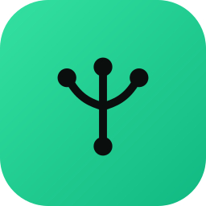

#  Tautree — Roadmap v2

🇬🇧 **[Read in English →](./ROADMAP.md)** · 📖 **[README →](./README.id.md)**

Alternatif Linktree yang self-hostable: tiap user punya satu halaman publik (`your-domain.com/username`) berisi daftar link, dikelola lewat dashboard pribadi.

> **v1 (MVP) sudah selesai & live di Coolify.** Roadmap ini fokus ke fase pasca-launch: hardening, fitur bernilai langsung, analytics, dan monetisasi. Detail v1 ada di bagian [Arsip v1](#arsip--v1-mvp-selesai) di bawah.

## Tech Stack

| Layer       | Pilihan                                          | Status |
| ----------- | ------------------------------------------------ | ------ |
| Framework   | Next.js 15 (App Router) + TypeScript             | ✅     |
| UI          | shadcn v4 (Base UI + Radix) + Tailwind v4        | ✅     |
| Theme/Toast | next-themes + sonner                             | ✅     |
| Database    | PostgreSQL (host-resident, via Docker Compose)   | ✅     |
| ORM         | Prisma 7                                         | ✅     |
| Auth        | Auth.js (NextAuth v5, JWT) — Google + magic link | ✅     |
| Testing     | Vitest (unit)                                    | ✅     |
| CI          | GitHub Actions (typecheck + lint + test + build) | ✅     |
| Deploy      | Coolify (self-hosted, Docker)                    | ✅     |

## Data Model (saat ini)

```
User        → id, email, username, name, bio, avatarUrl, theme, customTheme(Json),
              buttonShape, buttonFill, font, role(USER|ADMIN), suspended
Link        → id, userId, type(LINK|HEADER|EMBED), title, url?, thumbnail?, featured,
              order, isActive, clicks, startsAt?, endsAt?
SocialLink  → id, userId, url, order                     # social icon row di header
Click       → id, linkId, createdAt                       # per-click time-series
ProfileView → id, userId, device, referrer?, createdAt    # privacy-friendly view log (no IP/cookie)
+ Auth.js: Account, Session, VerificationToken
```

---

## Fase 6 — Production Hardening 🛡️

> De-risk yang udah live. Prioritas tertinggi.

- [x] CI: tambah step `build` (tangkap error RSC sebelum deploy)
- [x] Global `app/error.tsx` + `global-error.tsx` + `not-found.tsx` + dashboard `loading.tsx`
- [x] Refactor logika gating → `isLinkLive` (`lib/links.ts`) + `isProfilePublic` (`lib/profile.ts`), dipakai di page/OG/redirect, + unit test anti-regresi
- [x] `robots.ts` + `sitemap.ts` (`force-dynamic`, profil non-suspended ber-username)
- [ ] Rate limit durable (Postgres/Redis) — **trigger: saat scale > 1 container**
- [ ] Error monitoring (Sentry / log terstruktur) — opsional tapi murah
- [ ] Keputusan: suspended = sembunyi publik (sekarang) **atau** blokir login total?

## Fase 7 — Link Power-ups ⚡

> Nilai langsung kelihatan di halaman publik.

- [x] Auto social icons — `detectPlatform` (`lib/social.ts`) + `SocialIcon` (simple-icons, 17 platform) di tombol publik, fallback globe
- [x] Scheduling link — kolom `startsAt`/`endsAt` (null = tanpa batas), gating di `isLinkLive` + `liveScheduleWhere` (query publik & redirect), datetime-local di dialog (ISO/UTC, timezone-safe), badge Scheduled/Expired di dashboard, unit test
- [x] Tipe link baru: header/divider (grouping) — enum `LinkType` (`LINK`/`HEADER`), `url` nullable, render section label di halaman publik, type selector + badge di dashboard, gating redirect anti header, unit test `parseLinkKind`
- [x] Embed — YouTube/Spotify inline via `LinkType.EMBED` + `lib/embed.ts` (`getEmbed` parse URL→iframe src, id di-sanitasi), render iframe responsif (YT 16:9, Spotify tinggi adaptif) di halaman publik, opsi Embed di dialog + validasi provider, unit test
- [x] Thumbnail/icon kustom per link — kolom `thumbnail` (data URI), resize di client (canvas 128px → WebP), validasi + cap ukuran server (`parseThumbnail`, tolak svg/non-image), upload/preview/remove di dialog, render di tombol publik (override social icon), unit test. Zero-infra (no S3/volume).

## Fase 8 — Analytics & Growth 📈

> Bikin user balik & ngerti performa.

- [x] Analytics lanjut: referrer + device (geo ditunda — perlu geo-IP) — model `ProfileView` (device + referrer host, tanpa IP/UA/cookie), `<ViewTracker>` client beacon kirim `document.referrer` ke `/api/v/[id]`, helper `lib/analytics.ts` (`classifyDevice`/`isBot`/`referrerLabel`) + unit test, dashboard nampilin Views/Top sources/Devices
- [x] Export analytics ke CSV — route `GET /dashboard/analytics/export` (auth, ikut `?from&to` + `resolveRange`), CSV harian (date/views/clicks) via `toCsv` (escape RFC-4180), tombol download di dashboard, unit test
- [x] QR code per halaman profil — generate PNG data URI server-side (`qrcode`, pure-JS, EC level H) untuk URL publik; `<QrCard>` nampilin QR + brand logo di tengah + URL caption, tombol Download PNG composite QR+logo+URL ke canvas client-side (logo & URL ikut ke file)
- [x] Range tanggal custom di dashboard analytics — `resolveRange` (default 30 hari, cap 366, validasi + clamp) + `<AnalyticsRangePicker>` (date-range-picker → URL `?from&to`), semua query (clicks/views/devices/sources) ikut window, series harian dinamis, unit test

## Fase 9 — Monetisasi 💳 (opsional)

> Kalau mau jadiin produk berbayar.

- [ ] Tier berbayar: hapus branding "Made with Tautree", analytics lanjut, link unlimited
- [ ] Billing — Stripe / Lemon Squeezy + webhook → update tier di DB
- [ ] Verifikasi/badge centang
- [ ] Panel admin: lihat tier & status billing per user

## Fase 10 — Custom Domain 🌐 (paling kompleks)

> User pakai domain sendiri (`links.budi.com`).

- [ ] Tambah domain per user + verifikasi kepemilikan via DNS TXT
- [ ] Routing multi-tenant (middleware: map host → username)
- [ ] TLS otomatis (Coolify/Caddy on-demand cert)

## Fase 11 — Public Page Enhancements 🎨

> Bikin halaman publik lebih ekspresif & "punya sendiri". Semua nilai langsung kelihatan ke pengunjung. ⭐ = rekomendasi prioritas (rasio dampak/effort tinggi).

**Visual / polish**

- [x] ⭐ Button style variants — kolom `buttonShape`/`buttonFill` di User, `lib/button-style.ts` (`linkButtonAppearance` → inline style, validasi + default), selector Shape/Fill + live preview di Appearance, diterapkan ke tombol & embed di halaman publik, unit test
- [x] Font picker — kolom `font` di User, `lib/fonts.ts` (`fontStack`/`parseFont`, 4 pilihan: Sans/Serif/Mono/Rounded via CSS stacks — zero web-font tambahan), selector + live preview di Appearance, diterapkan ke `<main>` halaman publik, unit test
- [ ] Cover/banner image — header di belakang avatar; **reuse pola client-resize dari thumbnail**. _(sedang)_

**Konten link**

- [x] Social icon row — model `SocialLink` (url + order, cap `SOCIAL_MAX`=8), manager add/remove di halaman Profile, ikon di-derive via `detectPlatform`/`SocialIcon`, render deretan ikon di header publik (buka tab baru, gak nge-track klik)
- [x] Featured/pinned link — kolom `featured` di Link (khusus LINK), checkbox di dialog + star di dashboard, di halaman publik di-pin ke atas sebagai hero card (padding/teks/ikon lebih besar), sisanya tetap urut + grouping
- [ ] vCard "Save contact" — tombol download `.vcf` ke HP; diferensiator personal brand, zero infra. _(kecil–sedang)_

**Growth / interaksi**

- [x] ⭐ Share + QR di halaman publik — `<ShareButton>` (copy link / native share / QR) di pojok profil; QR via route on-demand `GET /api/qr/[username]` (cache 1 hari, gak nge-bloat HTML), QR baru di-fetch saat dialog dibuka
- [ ] Email capture / "Subscribe" — kumpulin email pengunjung (lead-gen); butuh model + storage + pertimbangan privacy. _(sedang, nilai tinggi)_

## Fase 12 — Development Workflow 🧰

> Samain workflow development dengan [Ostra](https://github.com/ByHandi/ostra): aturan proses dikunci lewat tooling, bukan cuma ditulis. Tiap item punya GitHub issue, dikelompokkan ke milestone versi.

**[v0.2.0](https://github.com/ByHandi/tautree/milestone/1) — Development Workflow & Quality Gates**

- [x] Model branch — `dev` jadi branch integrasi; semua PR development ke `dev`, dan saat milestone selesai, release PR merge `dev` → `main`. Didokumentasikan di CONTRIBUTING.md; CI jalan di PR ke `dev` dan `main` — [#10](https://github.com/ByHandi/tautree/issues/10)
- [ ] Issue key `TAUTREE-XX` + penamaan branch (`feat/TAUTREE-XX-…`), PR di-link manual ke issue-nya (sidebar Development; `Closes #N` nggak jalan di PR ke `dev`), GitHub Issues sebagai backlog — [#11](https://github.com/ByHandi/tautree/issues/11)
- [x] `CHANGELOG.md` (Keep a Changelog + SemVer, section `[Unreleased]`, backfill `0.1.0`) — [#12](https://github.com/ByHandi/tautree/issues/12)
- [x] Samain versi Node di CONTRIBUTING.md, README, dan template bug report dengan CI/Docker (24) — [#21](https://github.com/ByHandi/tautree/issues/21)
- [ ] Pre-commit hook husky + lint-staged (Prettier, `eslint --fix`, typecheck) — [#13](https://github.com/ByHandi/tautree/issues/13)
- [ ] Batas complexity di ESLint: cyclomatic 15 + `sonarjs/cognitive-complexity` 15 — [#14](https://github.com/ByHandi/tautree/issues/14)
- [ ] Hardening CI: permissions read-only, `prettier --check`, `npm audit`, jadwal mingguan, validasi Docker/compose — [#17](https://github.com/ByHandi/tautree/issues/17)
- [ ] `AGENTS.md` lengkap (task discovery, git policy, urutan layer fitur, konvensi, verifikasi) + `CLAUDE.md` yang meng-import-nya — [#15](https://github.com/ByHandi/tautree/issues/15)
- [ ] Template feature request jadi mini-PRD (desain backend, alur UI, checklist acceptance criteria) — [#16](https://github.com/ByHandi/tautree/issues/16)

**[v0.3.0](https://github.com/ByHandi/tautree/milestone/2) — Release Automation & Maintenance**

- [ ] Release workflow: release PR `dev` → `main` di-merge → tag `vX.Y.Z` di `main` → CI → GitHub Release dengan notes dari CHANGELOG (image GHCR opsional) — [#18](https://github.com/ByHandi/tautree/issues/18)
- [ ] Dependabot: bulanan, satu PR per ecosystem (npm, docker, compose, actions) — [#19](https://github.com/ByHandi/tautree/issues/19)
- [ ] Project Claude skills (`add-feature`, `cut-release`) + `.claude/launch.json` — [#20](https://github.com/ByHandi/tautree/issues/20)

---

## Arsip — v1 (MVP, selesai)

<details>
<summary>Fase 0–5 — semua ✅</summary>

- **Fase 0 — Fondasi:** route group dashboard, root layout publik, landing, bersihin template registry.
- **Fase 1 — Data Layer:** Postgres + Prisma 7 (generator `prisma-client`, driver adapter `@prisma/adapter-pg`, config di `prisma.config.ts`), model + migrasi + seed.
- **Fase 2 — Auth & Onboarding:** Auth.js v5 JWT, Google + magic link, adapter Prisma, middleware proteksi, onboarding username real-time. `allowDangerousEmailAccountLinking` aktif di Google (aman, email terverifikasi).
- **Fase 3 — Dashboard CRUD:** list/tambah/edit/hapus link, reorder drag-and-drop (`dnd-kit`), toggle aktif, edit profil.
- **Fase 4 — Halaman Publik:** `/[username]` mobile-first, hanya link aktif & terurut, track klik via `/api/r/[id]`, 404 state, OG image + SEO dinamis. Gating `suspended` di semua jalur (page, OG, redirect).
- **Fase 5 — Polish SaaS:** 6 preset tema **+ custom color** (color picker, palette Json, validasi hex-only), analytics dasar (grafik 30 hari, model `Click`), validasi URL + rate limit, deploy Coolify, **panel admin** (`/admin`: role di DB, list+cari user, suspend, hapus link/user), **admin seed** dari `ADMIN_EMAIL` (idempotent, di entrypoint).
- **Hardening awal:** Vitest (32 unit test untuk validasi keamanan) + CI GitHub Actions.

</details>
